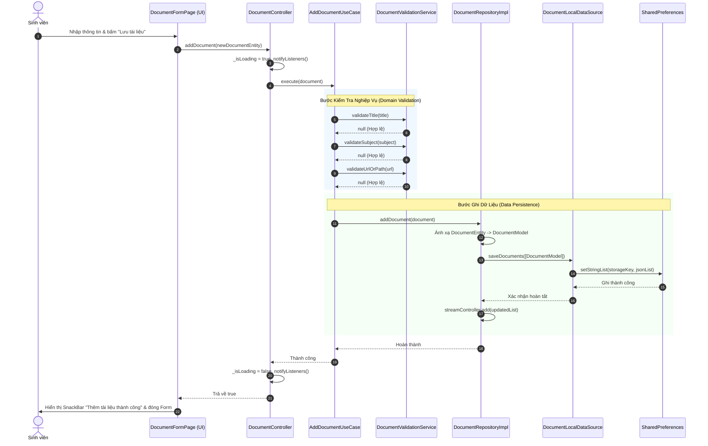
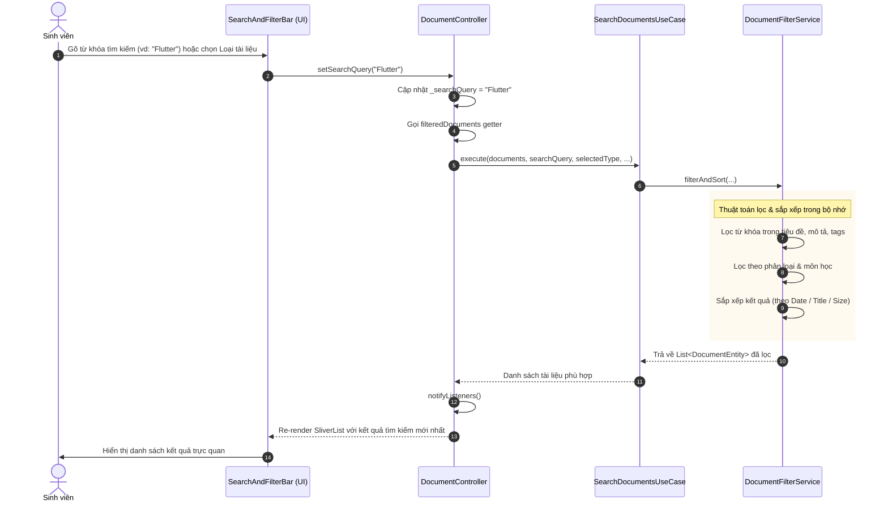
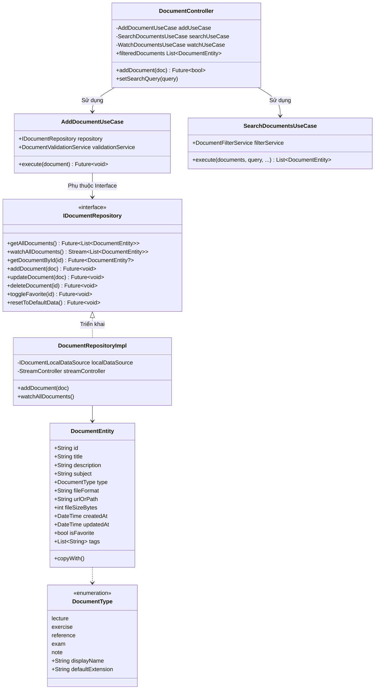

# 📐 TÀI LIỆU THIẾT KẾ HỆ THỐNG (DESIGN.md)
## ĐỒ ÁN: ỨNG DỤNG QUẢN LÝ TÀI LIỆU HỌC TẬP THEO KIẾN TRÚC CASHEW
> **Dự án:** Cashew StudyDocs (`cashew_study_docs`)  
> **Tham chiếu kiến trúc:** [Cashew - Open Source Flutter Project](https://github.com/jameskokoska/Cashew)  
> **Nền tảng:** Flutter (Dart 3.x) & Material 3  

---

## 1. TỔNG QUAN HỆ THỐNG & MỤC TIÊU THIẾT KẾ

Hệ thống **Cashew StudyDocs** là ứng dụng chuyên biệt hỗ trợ sinh viên và giảng viên số hóa, lưu trữ, tra cứu và phân loại tài liệu học tập (bài giảng, bài tập lớn, giáo trình tham khảo, đề thi và ghi chú). 

Ứng dụng áp dụng thiết kế phân tầng theo tiêu chuẩn **Clean Architecture** kết hợp mô hình **Reactive Data Streams** của dự án thực tế Cashew, đảm bảo:
- **Độc lập nghiệp vụ (Domain Independence):** Tầng Domain không phụ thuộc vào Framework giao diện hay Thư viện lưu trữ dữ liệu.
- **Tính mô-đun hóa cao (High Modularity):** Phân tách độc lập giữa Use Cases, Repositories, Data Sources và UI Controllers.
- **Khả năng mở rộng bền vững (Scalability):** Dễ dàng hoán đổi tầng lưu trữ từ SharedPreferences sang SQLite (Drift), Hive hoặc Cloud Backend mà không cần sửa đổi Presentation hay Use Cases.
- **Dễ kiểm thử tự động (Testability):** Cho phép Mocking / Faking các phụ thuộc để viết Unit Test cho từng tầng riêng biệt.

---

## 2. PHÂN TÍCH USE CASES HỆ THỐNG

### 2.1. Danh sách Tác nhân (Actors)
- **Học viên / Sinh viên:** Người dùng trực tiếp thêm tài liệu, tra cứu, xem chi tiết, tải/mở liên kết và gắn thẻ yêu thích.

### 2.2. Bảng Tóm Tắt Use Cases Cốt Lõi

| Mã Use Case | Tên Use Case | Tầng phụ trách | Mô tả ngắn |
|:---:|:---|:---:|:---|
| **UC01** | **Nộp mới tài liệu** | `UseCases / AddDocumentUseCase` | Nộp tệp tài liệu từ thiết bị, tự động nhận diện dung lượng/định dạng và lưu trữ |
| **UC02** | **Cập nhật tài liệu** | `UseCases / UpdateDocumentUseCase` | Chỉnh sửa tiêu đề, môn học, đổi tệp đính kèm hoặc thẻ tags |
| **UC03** | **Xóa tài liệu** | `UseCases / DeleteDocumentUseCase` | Xóa tài liệu khỏi bộ nhớ có hộp thoại xác nhận bảo vệ |
| **UC04** | **Tìm kiếm & Lọc** | `UseCases / SearchDocumentsUseCase` | Tìm kiếm thời gian thực theo từ khóa, lọc theo loại, môn học, sắp xếp |
| **UC05** | **Đánh dấu Yêu thích** | `UseCases / ToggleFavoriteUseCase` | Đổi trạng thái quan trọng/yêu thích của tài liệu |
| **UC06** | **Theo dõi dữ liệu phản ứng** | `UseCases / WatchDocumentsUseCase` | Lắng nghe luồng dữ liệu thời gian thực (Reactive Stream) từ Repository |

---

### 2.3. Đặc Tả Chi Tiết Hai Use Cases Trọng Tâm

#### 🎯 Use Case UC01: Nộp mới tài liệu học tập (Submit & Add Document)
- **Tác nhân:** Sinh viên.
- **Tiền điều kiện:** Ứng dụng đã khởi tạo thành công và kết nối bộ lưu trữ.
- **Dữ liệu đầu vào:** Tệp tin tải lên từ thiết bị (PDF, Word DOCX, PowerPoint PPTX, Excel XLSX, ZIP,...) hoặc chọn tệp mẫu, Tiêu đề (bắt buộc, >= 3 ký tự), Môn học (bắt buộc), Phân loại tài liệu (`DocumentType`), Định dạng file, Đường dẫn lưu trữ tệp, Dung lượng tệp (MB), Thẻ tags.
- **Luồng sự kiện chính (Normal Flow):**
  1. Người dùng mở màn hình `DocumentFormPage` từ nút FAB trên `HomePage`.
  2. Người dùng nhấn vào "Khu vực Nộp Tệp Học Tập" để chọn tệp tài liệu trực tiếp từ máy tính/thiết bị (thông qua `file_picker`) hoặc bấm chọn nhanh một tệp mẫu có sẵn.
  3. Hệ thống tự động trích xuất tên tệp, định dạng phần mở rộng và kích thước tệp theo MB, hiển thị thẻ "Tệp Đã Nộp" kèm huy hiệu trạng thái xanh.
  4. Người dùng xác nhận tiêu đề môn học, loại học liệu và nhấn nút "Xác nhận nộp vào kho học liệu".
  5. `DocumentController` tiếp nhận yêu cầu và chuyển dữ liệu sang `AddDocumentUseCase`.
  6. `AddDocumentUseCase` kích hoạt `DocumentValidationService` để kiểm tra toàn bộ trường dữ liệu và tính hợp lệ của tệp đính kèm.
  7. Nếu dữ liệu hợp lệ, `AddDocumentUseCase` gọi `IDocumentRepository.addDocument(entity)`.
  8. `DocumentRepositoryImpl` chuyển đổi `Entity` sang `DocumentModel` và chuyển xuống `DocumentLocalDataSource`.
  9. `DocumentLocalDataSource` tuần tự hóa JSON và lưu trữ vào `SharedPreferences`.
  10. `DocumentRepositoryImpl` phát tín hiệu danh sách tài liệu mới vào `StreamController.broadcast()`.
  11. `DocumentController` nhận dữ liệu từ Stream, gọi `notifyListeners()`.
  12. Giao diện người dùng tự động re-render và hiển thị thông báo thành công.
- **Luồng ngoại lệ (Exception Flow):**
  - Nếu chưa nộp tệp hoặc tiêu đề < 3 ký tự hoặc môn học rỗng: `DocumentValidationService` phát hiện và ném `ArgumentError` (hoặc hiển thị lỗi validation trên giao diện form), hủy bỏ thao tác ghi dữ liệu.

---

#### 🔍 Use Case UC04: Tìm kiếm & Lọc tài liệu học tập (Search & Filter)
- **Tác nhân:** Sinh viên.
- **Tiền điều kiện:** Ứng dụng hiển thị danh sách tài liệu trên `HomePage`.
- **Dữ liệu đầu vào:** Từ khóa tìm kiếm (`searchQuery`), Phân loại tài liệu (`DocumentType`), Môn học (`selectedSubject`), Cờ yêu thích (`onlyFavorites`), Tùy chọn sắp xếp (`sortOption`).
- **Luồng sự kiện chính (Normal Flow):**
  1. Người dùng gõ từ khóa vào thanh tìm kiếm hoặc bấm chọn chip loại tài liệu (Bài giảng, Bài tập, Giáo trình,...).
  2. Sự kiện UI gọi đến hàm tương ứng trên `DocumentController` (`setSearchQuery`, `setSelectedType`,...).
  3. `DocumentController` lưu giữ tiêu chí lọc và gọi `SearchDocumentsUseCase.execute()`.
  4. `SearchDocumentsUseCase` ủy nhiệm thuật toán cho `DocumentFilterService`:
     - So khớp từ khóa không phân biệt hoa thường trong tiêu đề, mô tả, môn học và danh sách thẻ tags.
     - Lọc chính xác theo `selectedType` và `selectedSubject`.
     - Lọc theo cờ `onlyFavorites` nếu được kích hoạt.
     - Sắp xếp kết quả theo tiêu chí được chỉ định (Ngày tạo giảm dần/tăng dần, Tiêu đề A-Z, Dung lượng file).
  5. `DocumentController` nhận danh sách đã lọc và gọi `notifyListeners()`.
  6. Widget `ListView` trên giao diện re-render tức thì kết quả tìm kiếm kèm theo số lượng đếm thống kê.

---

## 3. SƠ ĐỒ LUỒNG DỮ LIỆU TỔNG QUAN (MERMAID DATA FLOW)

Mô hình luồng dữ liệu 2 chiều: Chiều xuôi (Lệnh thực thi từ UI xuống Storage) và Chiều ngược (Luồng Reactive Stream tự động đẩy dữ liệu lên UI).

```mermaid
flowchart TD
    subgraph PresentationLayer["TẦNG PRESENTATION (Giao diện & Quản lý trạng thái)"]
        UI_Home["HomePage (Dashboard & Danh sách)"]
        UI_Form["DocumentFormPage (Thêm / Chỉnh sửa)"]
        UI_Detail["DocumentDetailPage (Chi tiết tài liệu)"]
        Ctrl["DocumentController (ChangeNotifier / ViewModel)"]
    end

    subgraph UseCasesLayer["TẦNG USE CASES (Logic Nghiệp vụ Ứng dụng)"]
        UC_Add["AddDocumentUseCase"]
        UC_Update["UpdateDocumentUseCase"]
        UC_Delete["DeleteDocumentUseCase"]
        UC_Search["SearchDocumentsUseCase"]
        UC_Watch["WatchDocumentsUseCase"]
        UC_Fav["ToggleFavoriteUseCase"]
    end

    subgraph DomainLayer["TẦNG DOMAIN (Nghiệp vụ Cốt lõi Độc lập)"]
        ValService["DocumentValidationService"]
        FiltService["DocumentFilterService"]
        IRepo["<<Interface>> IDocumentRepository"]
        Entities["DocumentEntity & DocumentType"]
    end

    subgraph DataLayer["TẦNG DATA (Dữ liệu & Triển khai)"]
        RepoImpl["DocumentRepositoryImpl"]
        Model["DocumentModel (JSON Serialization)"]
        LocalDS["DocumentLocalDataSource"]
        SP[("SharedPreferences Storage")]
    end

    %% Presentation -> Use Cases
    UI_Form -->|1. Submit Form| Ctrl
    UI_Home -->|1. Input Tìm kiếm / Lọc| Ctrl
    Ctrl -->|2. Ủy quyền thực thi nghiệp vụ| UC_Add
    Ctrl -->|2. Yêu cầu lọc danh sách| UC_Search
    Ctrl -->|2. Xóa tài liệu| UC_Delete

    %% Use Cases -> Domain & Interfaces
    UC_Add -->|3. Kiểm tra tính hợp lệ| ValService
    UC_Add -->|4. Ghi dữ liệu qua Interface| IRepo
    UC_Search -->|3. Thuật toán tìm kiếm & sắp xếp| FiltService
    UC_Delete -->|3. Xóa qua Interface| IRepo

    %% Dependency Inversion: Interface -> Implementation
    IRepo -.->|Hiện thực hóa| RepoImpl

    %% Data Processing
    RepoImpl -->|5. Ánh xạ Entity -> Model| Model
    RepoImpl -->|6. Ghi bộ nhớ| LocalDS
    LocalDS -->|7. Lưu trữ chuỗi JSON| SP

    %% Reactive Notification Stream
    RepoImpl -->|8. Phát sự kiện StreamController.broadcast()| IRepo
    IRepo -.->|9. Luồng Stream cập nhật| UC_Watch
    UC_Watch -.->|10. Luồng Stream| Ctrl
    Ctrl -->|11. notifyListeners()| UI_Home
    Ctrl -->|11. notifyListeners()| UI_Detail
```

---

## 4. SƠ ĐỒ TUẦN TỰ (MERMAID SEQUENCE DIAGRAMS)

### 4.1. Sơ đồ tuần tự: Use Case Thêm mới tài liệu (Add Document Sequence)



---

### 4.2. Sơ đồ tuần tự: Use Case Tìm kiếm & Lọc tài liệu (Search & Filter Sequence)



---

## 5. THIẾT KẾ CÁC LỚP KIẾN TRÚC THEO CHUẨN CASHEW



---

## 6. NGUYÊN TẮC THIẾT KẾ ÁP DỤNG

1. **Single Responsibility Principle (SRP):**
   - Mỗi Use Case (`AddDocumentUseCase`, `SearchDocumentsUseCase`, `DeleteDocumentUseCase`) chỉ đảm nhận duy nhất một luồng nghiệp vụ.
   - `DocumentValidationService` chỉ đảm nhận xác thực dữ liệu.
2. **Open/Closed Principle (OCP):**
   - Thêm bộ lưu trữ mới (ví dụ SQLite Drift giống Cashew) chỉ cần triển khai lớp mới kế thừa `IDocumentRepository` mà không cần sửa đổi bất kỳ Use Case nào.
3. **Liskov Substitution Principle (LSP):**
   - `DocumentModel` kế thừa trọn vẹn `DocumentEntity` và có thể thay thế mọi nơi `DocumentEntity` được yêu cầu.
4. **Interface Segregation Principle (ISP):**
   - Hợp đồng `IDocumentRepository` gọn gàng, định nghĩa đúng các phương thức cần thiết cho quản lý tài liệu.
5. **Dependency Inversion Principle (DIP):**
   - Các Use Cases và Controllers phụ thuộc vào trừu tượng `IDocumentRepository`, không phụ thuộc trực tiếp vào triển khai cụ thể `DocumentRepositoryImpl` hay `SharedPreferences`.

---
*Tài liệu được biên soạn hoàn chỉnh phục vụ đánh giá thiết kế đồ án.*
