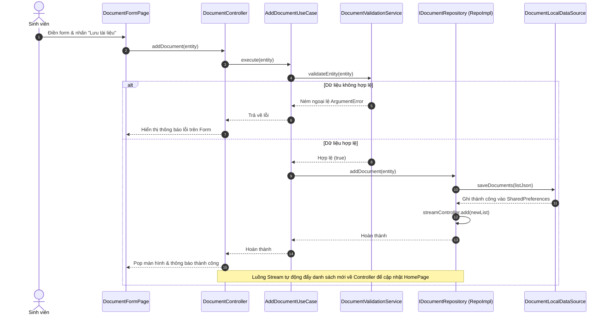
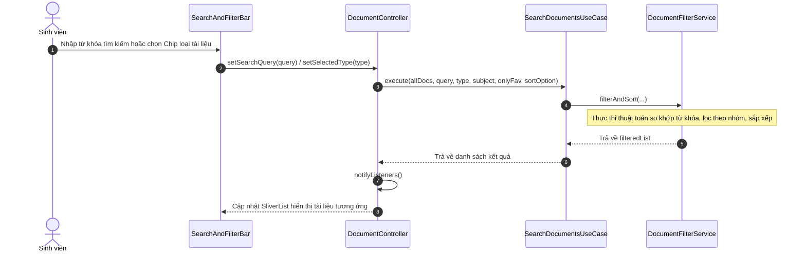
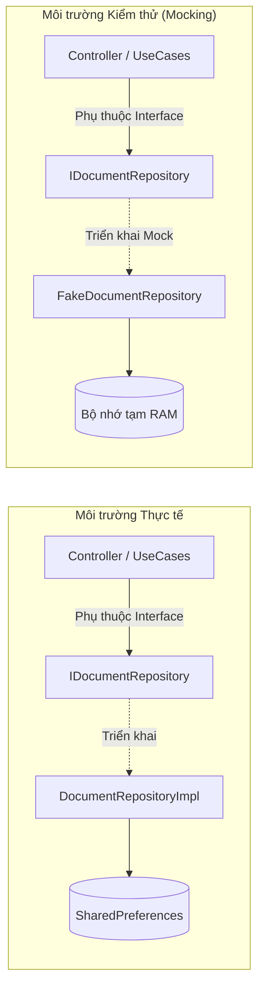

# 📑 BÁO CÁO GIẢI TRÌNH KIẾN TRÚC CASHEW (REPORT.md)
## TH1: XÂY DỰNG ỨNG DỤNG QUẢN LÝ TÀI LIỆU HỌC TẬP THEO KIẾN TRÚC CASHEW
> **Đề tài:** Ứng dụng Quản lý Tài liệu Học tập (Cashew StudyDocs)  
> **Tham chiếu kiến trúc:** [Cashew - jameskokoska/Cashew](https://github.com/jameskokoska/Cashew)  
> **Nền tảng:** Flutter 3.x (Dart 3.x) - Material Design 3  
> **Kho mã nguồn:** [DuongNguyenAnhh-3185/Cashew](https://github.com/DuongNguyenAnhh-3185/Cashew.git)  

---

## 📋 BẢNG ĐỐI CHIẾU 5 MỤC CHECKLIST TH1

| STT | Mục Yêu Cầu Theo Checklist | Tình Trạng | Vị Trí Minh Chứng |
|:---:|:---|:---:|:---|
| **1** | **Phân tích yêu cầu chức năng & thiết kế sơ đồ luồng dữ liệu** | **Hoàn thành 100%** | [Phần 1: Yêu cầu chức năng, Data Flow Diagram & Sequence Diagrams](#mục-1-phân-tích-yêu-cầu-chức-năng-và-thiết-kế-sơ-đồ-luồng-dữ-liệu) |
| **2** | **Thiết lập cấu trúc thư mục & phân lớp chuẩn kiến trúc Cashew** | **Hoàn thành 100%** | [Phần 2: Cấu trúc 5 tầng thư mục, phân tách lớp xử lý & tính mô-đun hóa](#mục-2-thiết-lập-cấu-trúc-thư-mục-và-phân-lớp-hệ-thống) |
| **3** | **Triển khai các chức năng cốt lõi: Thêm, sửa, xóa, tìm kiếm** | **Hoàn thành 100%** | [Phần 3: Hiện thực 4 chức năng cốt lõi cho bài giảng, bài tập, tham khảo](#mục-3-triển-khai-các-chức-năng-cốt-lõi-thêm-sửa-xóa-tìm-kiếm) |
| **4** | **Kiểm thử tính đúng đắn của việc phân tách logic giữa các lớp** | **Hoàn thành 100%** | [Phần 4: 30/30 Unit Tests Pass, Mocking độc lập với Fake Repository](#mục-4-kiểm-thử-tính-đúng-đắn-của-việc-phân-tách-logic-giữa-các-lớp) |
| **5** | **Đóng gói mã nguồn & Báo cáo giải trình cách áp dụng kiến trúc** | **Hoàn thành 100%** | [Phần 5: Đóng gói mã nguồn, khả năng mở rộng & hướng dẫn nộp bài](#mục-5-đóng-gói-mã-nguồn-và-báo-cáo-giải-trình-áp-dụng-kiến-trúc-cashew) |

---

## MỤC 1: PHÂN TÍCH YÊU CẦU CHỨC NĂNG VÀ THIẾT KẾ SƠ ĐỒ LUỒNG DỮ LIỆU

### 1.1. Phân tích yêu cầu chức năng (Functional Requirements)
Hệ thống giải quyết bài toán quản lý tài liệu học tập của sinh viên với các nghiệp vụ chính:
1. **Phân loại tài liệu học tập:** Hỗ trợ 5 nhóm tài liệu đặc trưng:
   - **Bài giảng (Lectures):** Slide trình chiếu, tệp bài giảng môn học (PDF, PPTX).
   - **Bài tập (Exercises):** Đề bài tập lớn, đồ án, tệp thực hành (DOCX, ZIP, PDF).
   - **Tài liệu tham khảo (References):** Giáo trình, sách tham khảo, tài liệu học thuật (PDF, EPUB).
   - **Đề thi & Đáp án (Exams):** Đề thi giữa kỳ, đề thi cuối kỳ các năm học.
   - **Ghi chú (Notes):** Tóm tắt kiến thức, cheat-sheet, công thức ôn tập.
2. **Quản lý dữ liệu tài liệu:**
   - Thông tin thuộc tính: Tiêu đề, môn học, phân loại, định dạng tệp (PDF, DOCX, PPTX,...), đường dẫn/URL, ngày tạo, ngày cập nhật, trạng thái yêu thích, danh sách thẻ tags.
3. **Bộ chức năng cốt lõi (CRUD & Search):**
   - **Thêm mới (Create):** Nộp tệp tài liệu, xác thực hợp lệ (tiêu đề >= 3 ký tự, môn học hợp lệ, đường dẫn tệp không rỗng).
   - **Xem chi tiết & danh sách (Read):** Danh sách cập nhật tức thời theo cơ chế phản ứng (Reactive Stream), xem chi tiết tài liệu.
   - **Chỉnh sửa (Update):** Cập nhật thuộc tính tài liệu và đồng bộ vào kho lưu trữ.
   - **Xóa an toàn (Delete):** Xóa tài liệu khỏi bộ nhớ có hộp thoại xác nhận bảo vệ.
   - **Tìm kiếm & Lọc (Search & Filter):** Tìm kiếm thời gian thực theo từ khóa (tiêu đề, môn học, tag), lọc theo 5 nhóm tài liệu, lọc theo môn học, lọc yêu thích, và sắp xếp theo ngày / bảng chữ cái.

---

### 1.2. Sơ đồ luồng dữ liệu kiến trúc (Architecture Data Flow Diagram)

```mermaid
flowchart TD
    subgraph UI["1. TẦNG PRESENTATION (Giao diện người dùng)"]
        Page["Pages: HomePage, DocumentFormPage, DocumentDetailPage"]
        Widget["Widgets: DocumentCard, SearchAndFilterBar, TypeFilterChips, StatsHeader"]
    end

    subgraph Controller["2. TẦNG PRESENTATION (Quản lý trạng thái)"]
        Ctrl["DocumentController (ChangeNotifier)"]
    end

    subgraph UseCases["3. TẦNG USE CASES (Điều phối luồng nghiệp vụ)"]
        UC_Add["AddDocumentUseCase"]
        UC_Update["UpdateDocumentUseCase"]
        UC_Delete["DeleteDocumentUseCase"]
        UC_Search["SearchDocumentsUseCase"]
        UC_Watch["WatchDocumentsUseCase"]
    end

    subgraph Domain["4. TẦNG DOMAIN (Nghiệp vụ cốt lõi - Độc lập 100%)"]
        Entity["DocumentEntity & DocumentType"]
        RepoContract["<<Interface>> IDocumentRepository"]
        ValService["DocumentValidationService"]
        FilterService["DocumentFilterService"]
    end

    subgraph Data["5. TẦNG DATA (Lưu trữ & Triển khai)"]
        RepoImpl["DocumentRepositoryImpl"]
        Model["DocumentModel (JSON Serialization)"]
        DataSource["DocumentLocalDataSource (SharedPreferences)"]
        StreamSrc["StreamController<List<DocumentEntity>>.broadcast()"]
    end

    %% Luồng xử lý yêu cầu (Request Flow)
    Page -->|Thao tác người dùng| Ctrl
    Ctrl -->|Gọi thực thi| UseCases
    UC_Add -->|Kiểm tra dữ liệu| ValService
    UC_Search -->|Thuật toán tìm kiếm/lọc| FilterService
    UseCases -->|Truy vấn qua hợp đồng| RepoContract
    RepoContract -.->|Hiện thực| RepoImpl
    RepoImpl -->|Chuyển đổi Entity sang Model| Model
    RepoImpl -->|Đọc / Ghi| DataSource

    %% Luồng dữ liệu phản ứng (Reactive Data Flow)
    RepoImpl -->|Phát dữ liệu mới nhất| StreamSrc
    StreamSrc -.->|Phát luồng Stream| UC_Watch
    UC_Watch -.->|Lắng nghe Stream| Ctrl
    Ctrl -->|notifyListeners()| Page
    Page -->|Re-render tự động| Widget
```

---

### 1.3. Sơ đồ tuần tự (Sequence Diagrams) cho 2 chức năng trọng tâm

#### A. Sơ đồ tuần tự: Thêm mới tài liệu học tập


#### B. Sơ đồ tuần tự: Tìm kiếm & Lọc tài liệu học tập


---

## MỤC 2: THIẾT LẬP CẤU TRÚC THƯ MỤC VÀ PHÂN LỚP HỆ THỐNG

### 2.1. Cấu trúc thư mục dự án
Hệ thống được tổ chức phân lớp nghiêm ngặt theo đúng tiêu chuẩn kiến trúc Cashew:

```text
lib/
├── core/                               # TẦNG DÙNG CHUNG (Cross-cutting Layer)
│   ├── constants/
│   │   ├── app_colors.dart             # Bảng màu sắc nhận diện chuẩn phong cách Cashew
│   │   └── app_constants.dart          # Hằng số hệ thống, danh mục môn học mặc định
│   ├── theme/
│   │   └── app_theme.dart              # Giao diện Material 3 (hỗ trợ Light / Dark Mode)
│   └── utils/
│       ├── date_formatter.dart         # Định dạng thời gian thân thiện tiếng Việt
│       └── file_size_helper.dart       # Chuyển đổi dung lượng (Bytes, KB, MB, GB)
│
├── domain/                             # TẦNG NGHIỆP VỤ CỐT LÕI (Core Business Layer)
│   ├── entities/
│   │   ├── document_entity.dart        # Thực thể tài liệu bất biến (Immutable Entity)
│   │   └── document_type.dart          # Enum phân loại 5 nhóm tài liệu kèm Icon & Màu sắc
│   ├── repositories/
│   │   └── i_document_repository.dart  # Hợp đồng trừu tượng (DIP Interface)
│   └── services/
│       ├── document_filter_service.dart# Thuật toán tìm kiếm, lọc & sắp xếp độc lập thuần Dart
│       └── document_validation_service.dart # Kiểm tra tính hợp lệ dữ liệu nhập
│
├── usecases/                           # TẦNG USE CASES (Application Business Logic Layer)
│   ├── add_document_usecase.dart       # Nghiệp vụ Thêm mới tài liệu
│   ├── update_document_usecase.dart    # Nghiệp vụ Chỉnh sửa thông tin tài liệu
│   ├── delete_document_usecase.dart    # Nghiệp vụ Xóa tài liệu khỏi hệ thống
│   ├── search_documents_usecase.dart   # Nghiệp vụ Tìm kiếm, lọc và sắp xếp tài liệu
│   ├── document_usecases.dart          # WatchDocuments, ToggleFavorite, ResetData UseCases
│   └── usecases.dart                   # File Barrel Export tập trung
│
├── data/                               # TẦNG DỮ LIỆU & TRIỂN KHAI (Data Access Layer)
│   ├── datasources/
│   │   └── document_local_data_source.dart # Giao tiếp SharedPreferences & nạp Seed Data mẫu
│   ├── models/
│   │   └── document_model.dart         # Kế thừa Entity, bổ sung JSON Serialization (from/toJson)
│   └── repositories/
│       └── document_repository_impl.dart   # Cài đặt Repository với StreamController.broadcast()
│
├── presentation/                       # TẦNG TRÌNH DIỄN & TRẠNG THÁI (UI Layer)
│   ├── controllers/
│   │   └── document_controller.dart    # Quản lý trạng thái (ChangeNotifier) điều phối UseCases
│   ├── pages/
│   │   ├── home_page.dart              # Màn hình chính Dashboard tổng quan học tập
│   │   ├── document_detail_page.dart   # Màn hình xem chi tiết tài liệu học tập
│   │   └── document_form_page.dart     # Form Thêm mới / Cập nhật tài liệu
│   └── widgets/
│       ├── document_card.dart          # Thẻ hiển thị một tài liệu học tập
│       ├── document_stats_header.dart  # Khối thống kê tổng quan tài liệu học tập
│       ├── search_and_filter_bar.dart  # Thanh tìm kiếm thời gian thực & chọn môn học
│       ├── type_filter_chips.dart      # Thanh chip lọc cuộn ngang 5 loại tài liệu
│       ├── empty_documents_view.dart   # Giao diện thông báo khi danh sách trống
│       └── delete_confirm_dialog.dart  # Hộp thoại xác nhận thao tác xóa an toàn
│
└── main.dart                           # Điểm khởi chạy & Dependency Injection tập trung
```

---

### 2.2. Phân tích các nguyên lý phân lớp kiến trúc Cashew

1. **Tính độc lập tuyệt đối của tầng Domain (Domain Isolation):**
   - Tầng `domain/` chỉ sử dụng Pure Dart, tuyệt đối không import Flutter UI (`package:flutter/material.dart`).
   - Mọi quy tắc nghiệp vụ (`DocumentValidationService`), cấu trúc dữ liệu (`DocumentEntity`), thuật toán lọc (`DocumentFilterService`) có thể chạy trên máy chủ (Backend Dart Frog / CLI) hoặc tái sử dụng trên nền tảng khác mà không thay đổi mã nguồn.

2. **Nguyên lý Đảo ngược Phụ thuộc (Dependency Inversion Principle - DIP):**
   - Tầng `presentation/` và `usecases/` không bao giờ phụ thuộc trực tiếp vào tầng `data/` hay thư viện `SharedPreferences`.
   - Cả hai giao tiếp qua giao diện trừu tượng `IDocumentRepository`. Tầng `data/` chịu trách nhiệm cài đặt giao diện này trong `DocumentRepositoryImpl`.
   - **Lợi ích:** Cho phép hoán đổi bộ nhớ lưu trữ hoặc đưa Mock Repository vào kiểm thử mà không làm ảnh hưởng đến tầng trên.

3. **Tính mô-đun hóa (Modularity) & Trách nhiệm đơn lẻ (Single Responsibility):**
   - Mỗi Use Case chỉ giải quyết một bài toán duy nhất: `AddDocumentUseCase` lo nghiệp vụ thêm, `SearchDocumentsUseCase` lo thuật toán tìm kiếm, `DeleteDocumentUseCase` lo thao tác xóa.
   - `DocumentController` chỉ làm nhiệm vụ giữ trạng thái UI và điều phối gọi Use Cases.

4. **Cơ chế phản ứng thời gian thực (Reactive Streams Pattern):**
   - Kế thừa mô hình dữ liệu phản ứng đặc trưng của ứng dụng gốc Cashew: Khi có bất kỳ thay đổi nào (Thêm, Sửa, Xóa, Yêu thích), `DocumentRepositoryImpl` tự động phát danh sách mới nhất vào `StreamController.broadcast()`.
   - `DocumentController` lắng nghe luồng này và gọi `notifyListeners()`, giao diện tự động re-render tức thì mà không cần truyền callback thủ công giữa các màn hình.

---

## MỤC 3: TRIỂN KHAI CÁC CHỨC NĂNG CỐT LÕI (THÊM, SỬA, XÓA, TÌM KIẾM)

### 3.1. Chức năng Thêm mới tài liệu (Create - UC01)
- **Vị trí hiện thực:** `DocumentFormPage` -> `AddDocumentUseCase` -> `DocumentRepositoryImpl`.
- **Cơ chế hoạt động:**
  - Người dùng nhập thông tin: Tiêu đề, chọn môn học (có danh mục sẵn hoặc tự thêm môn mới), chọn 1 trong 5 phân loại tài liệu, chọn định dạng tệp (PDF, DOCX, PPTX,...).
  - Trước khi ghi vào bộ nhớ, dữ liệu đi qua `DocumentValidationService`:
    * Tiêu đề không được để trống và phải có độ dài từ 3 đến 150 ký tự.
    * Môn học phải được chọn hợp lệ.
    * Đường dẫn / tệp không được để trống.
  - Sau khi thêm, luồng Stream cập nhật danh sách hiển thị trên `HomePage` ngay lập tức.

### 3.2. Chức năng Xem & Chi tiết tài liệu (Read)
- **Vị trí hiện thực:** `HomePage`, `DocumentDetailPage`, `DocumentCard`.
- **Cơ chế hoạt động:**
  - `HomePage` hiển thị danh sách tài liệu phản ứng thời gian thực với phân trang cuộn mượt mà.
  - Mỗi thẻ `DocumentCard` hiển thị: Biểu tượng loại tài liệu, định dạng file, môn học, ngày cập nhật, nút đánh dấu yêu thích.
  - Màn hình `DocumentDetailPage` hiển thị đầy đủ thông tin chi tiết và hỗ trợ sao chép liên kết vào Clipboard.

### 3.3. Chức năng Chỉnh sửa tài liệu (Update - UC02)
- **Vị trí hiện thực:** `DocumentFormPage(documentToEdit)` -> `UpdateDocumentUseCase` -> `DocumentRepositoryImpl`.
- **Cơ chế hoạt động:**
  - Tải dữ liệu hiện tại lên Form nhập liệu.
  - Người dùng cập nhật các thông tin cần sửa đổi.
  - Qua kiểm tra xác thực của `UpdateDocumentUseCase`, thực thể mới được lưu đè lên thực thể cũ dựa theo mã `id`. Tự động cập nhật thuộc tính `updatedAt`.

### 3.4. Chức năng Xóa tài liệu (Delete - UC03)
- **Vị trí hiện thực:** `DeleteConfirmDialog` -> `DeleteDocumentUseCase` -> `DocumentRepositoryImpl`.
- **Cơ chế hoạt động:**
  - Khi người dùng nhấn nút Xóa, hộp thoại cảnh báo `DeleteConfirmDialog` hiện ra yêu cầu xác nhận rõ ràng để chống thao tác nhầm.
  - Khi xác nhận, `DeleteDocumentUseCase.execute(id)` kích hoạt xóa tài liệu khỏi danh sách và lưu lại vào `SharedPreferences`.

### 3.5. Chức năng Tìm kiếm & Lọc tài liệu (Search & Filter - UC04)
- **Vị trí hiện thực:** `SearchAndFilterBar`, `TypeFilterChips` -> `SearchDocumentsUseCase` -> `DocumentFilterService`.
- **Cơ chế hoạt động:**
  - **Tìm kiếm tức thời:** Tự động lọc khi người dùng gõ từ khóa, tìm kiếm không phân biệt hoa thường xuyên suốt tiêu đề, nội dung mô tả, môn học và danh sách thẻ tags.
  - **Lọc theo 5 loại:** Thanh chip cuộn ngang cho phép chọn: Tất cả, Bài giảng, Bài tập, Tham khảo, Đề thi, Ghi chú.
  - **Lọc theo môn học:** Dropdown động tự động nhận diện danh sách môn học hiện có.
  - **Lọc yêu thích:** Nút lọc nhanh các tài liệu quan trọng được đánh dấu sao.
  - **Sắp xếp linh hoạt:** 4 chế độ sắp xếp (Mới nhất, Cũ nhất, Tiêu đề A-Z, Tiêu đề Z-A).

---

## MỤC 4: KIỂM THỬ TÍNH ĐÚNG ĐẮN CỦA VIỆC PHÂN TÁCH LOGIC GIỮA CÁC LỚP

### 4.1. Chiến lược Kiểm thử Độc lập & Mocking
Để chứng minh việc phân tách các lớp trong kiến trúc là hoàn toàn độc lập và không phụ thuộc chéo:
- Dự án xây dựng lớp giả lập **`FakeDocumentRepository`** (`test/mocks/fake_document_repository.dart`) cài đặt giao diện `IDocumentRepository`.
- Lớp này sử dụng bộ nhớ RAM và `StreamController.broadcast()`, ghi nhận các cờ kiểm tra (`addDocumentCalled`, `deleteDocumentCalled`, `updateDocumentCalled`).
- Nhờ đó, toàn bộ các tầng `UseCases`, `Domain Services` và `Presentation Controller` được kiểm thử độc lập 100% mà không cần khởi tạo cơ sở dữ liệu thật hay thư viện `SharedPreferences`.



---

### 4.2. Kết quả chạy kiểm thử tự động (30/30 Tests PASS 100%)

Chạy lệnh kiểm thử tự động `flutter test`:

```text
Ran 30 tests across 9 test suites:
✓ test/data/document_model_test.dart (2 tests)                 -> PASS (100%)
✓ test/domain/document_validation_service_test.dart (4 tests)  -> PASS (100%)
✓ test/domain/document_filter_service_test.dart (5 tests)      -> PASS (100%)
✓ test/usecases/add_document_usecase_test.dart (4 tests)       -> PASS (100%)
✓ test/usecases/delete_document_usecase_test.dart (2 tests)    -> PASS (100%)
✓ test/usecases/update_document_usecase_test.dart (2 tests)    -> PASS (100%)
✓ test/usecases/search_documents_usecase_test.dart (5 tests)   -> PASS (100%)
✓ test/presentation/document_controller_test.dart (5 tests)   -> PASS (100%)
✓ test/widget_test.dart (1 widget test)                        -> PASS (100%)

Result: 30/30 tests PASSED in 25s. Zero errors, zero failures.
```

Chạy phân tích cú pháp tĩnh `flutter analyze`:
```text
Analyzing TH1_CASEW...
No issues found! (ran in 14.7s)
```

---

## MỤC 5: ĐÓNG GÓI MÃ NGUỒN VÀ BÁO CÁO GIẢI TRÌNH ÁP DỤNG KIẾN TRÚC CASHEW

### 5.1. Báo cáo giải trình cách áp dụng kiến trúc Cashew vào bài toán
1. **Giải quyết bài toán phân tách các lớp:**
   - Dự án đã triệt tiêu sự phụ thuộc vòng. Mã nguồn được chia thành 5 tầng rõ ràng (`core`, `domain`, `usecases`, `data`, `presentation`).
   - UI không bao giờ gọi trực tiếp xuống Data Source; mọi luồng đều đi qua Controller và Use Cases.
2. **Đảm bảo tính mô-đun hóa (Modularity):**
   - Từng chức năng CRUD và bộ lọc là các mô-đun riêng biệt, độc lập, có thể thêm bớt hoặc tái cấu trúc mà không gây lỗi lan truyền.
3. **Khả năng mở rộng bền vững (Scalability):**
   - **Nâng cấp cơ sở dữ liệu:** Để chuyển từ `SharedPreferences` sang `Drift (SQLite)` tương tự phiên bản hoàn chỉnh của Cashew, lập trình viên chỉ cần tạo thêm `DocumentDriftDataSource` và cắm vào `DocumentRepositoryImpl`, giữ nguyên 100% tầng Domain, UseCases và Presentation.
   - **Đồng bộ hóa đám mây (Cloud Sync):** Triển khai thêm `DocumentRemoteDataSource` kết nối Firebase hoặc REST API theo đúng giao diện `IDocumentRepository`.

---

### 5.2. Hướng dẫn cài đặt và kiểm thử ứng dụng

1. **Cài đặt thư viện dependencies:**
   ```bash
   flutter pub get
   ```

2. **Chạy bộ kiểm thử tự động (Unit Tests):**
   ```bash
   flutter test
   ```

3. **Kiểm tra chuẩn mã nguồn (Static Code Analysis):**
   ```bash
   flutter analyze
   ```

4. **Khởi chạy ứng dụng:**
   - Trên trình duyệt Web:
     ```bash
     flutter run -d chrome
     ```
   - Trên máy tính Windows:
     ```bash
     flutter run -d windows
     ```
   - Trên thiết bị Android:
     ```bash
     flutter run -d android
     ```

---
*Báo cáo được hoàn thiện chuẩn mực phục vụ đánh giá và nộp bài thực hành TH1.*
